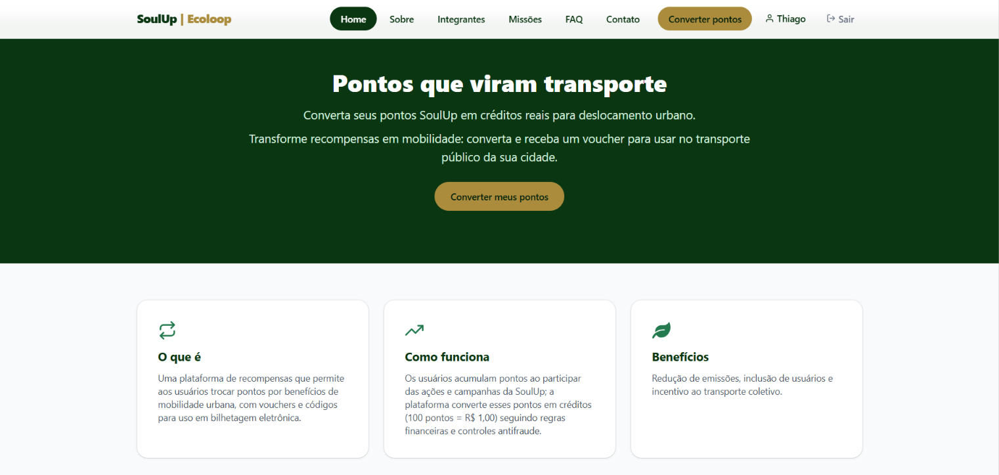
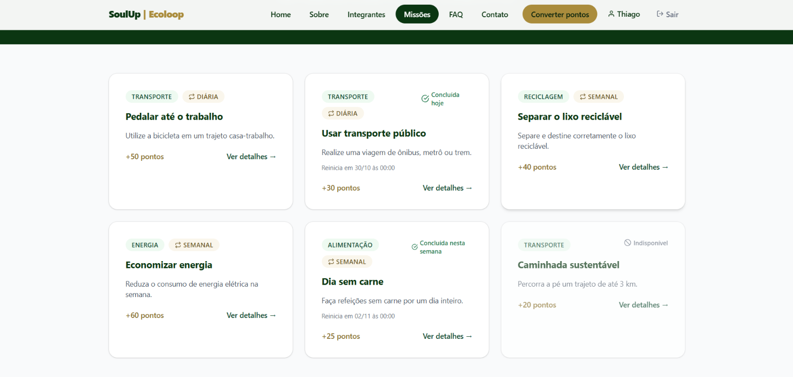
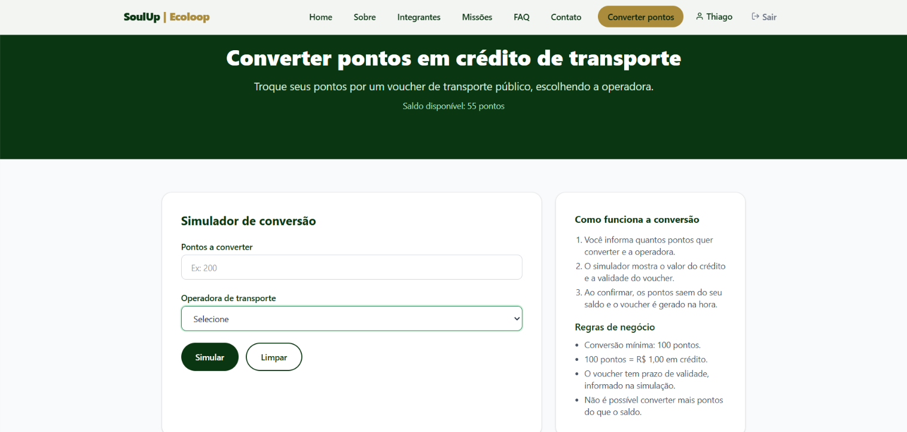

# SoulUp | Ecoloop 🌿🚌

Plataforma que transforma pontos acumulados pelos usuários da SoulUp em benefícios reais de mobilidade urbana. O front-end é uma SPA em **React + Vite + TypeScript**, com **Tailwind CSS**, **React Router** e **React Hook Form**, e na **Sprint 4** passou a ser **integrado à API Java (Spring Boot + Oracle)**, publicada na nuvem. Projeto do Challenge FIAP x SoulUp.

---

## 🔗 Links do projeto

| Item | Link |
|---|---|
| 🌐 Projeto publicado (Vercel) | `COLE_AQUI_A_URL_DA_VERCEL` |
| 🎥 Vídeo no YouTube (até 3 min) | `COLE_AQUI_O_LINK_DO_VIDEO` |
| 💻 Repositório no GitHub | https://github.com/Miguel-V-M-dev/Front-End_Challenge_2026_SoulUp |
| ⚙️ API publicada (Render) | https://ecoloop-api-080c.onrender.com |

> ⏳ A API roda em um servidor gratuito que **dorme quando fica parado**. A primeira requisição (cadastro, login ou abrir as missões) pode levar **até 1 minuto**. As telas mostram uma mensagem de carregamento enquanto isso.

---

## 📋 Descrição do Projeto

A **SoulUp | Ecoloop** permite que usuários convertam pontos em créditos de transporte público, recebendo um **voucher** com código, valor e validade. Os pontos são ganhos ao concluir **missões sustentáveis** (pedalar, usar transporte público, reciclar, economizar energia, comer sem carne) e o usuário ainda registra os quilômetros feitos de forma sustentável para acompanhar o **CO₂ economizado** e as **árvores equivalentes**.

O que existe na Sprint 4:

- **Cadastro e login** com sessão por token (JWT) que é restaurada ao abrir o site.
- **Missões** vindas do banco de dados, com **periodicidade** (única, diária, semanal ou mensal): uma missão diária concluída hoje volta a ficar disponível amanhã.
- **Conversor de pontos**: simulação, confirmação e geração do voucher pela API.
- **Perfil** com saldo, avatar (emoji ou imagem), missões concluídas, vouchers e registro de impacto ambiental.
- **Contato**: o formulário grava a mensagem no banco.
- Telas com estados de **carregando**, **erro** (com "tentar novamente") e **lista vazia**.

---

## 🛠️ Tecnologias Utilizadas

| Tecnologia | Uso |
|---|---|
| [React](https://react.dev) | Biblioteca de componentes e UI |
| [Vite](https://vite.dev) | Build tool e servidor de desenvolvimento |
| [TypeScript](https://www.typescriptlang.org) | Tipagem estática (inclui union e intersection types) |
| [Tailwind CSS](https://tailwindcss.com) | Estilização utilitária e responsividade |
| [React Router DOM](https://reactrouter.com) | Rotas estáticas, dinâmicas e protegidas (`useNavigate`, `useParams`) |
| [React Hook Form](https://react-hook-form.com) | Formulários validados (cadastro, login, contato, conversão e impacto) |
| [React Icons](https://react-icons.github.io/react-icons) | Ícones |
| `fetch` + API Java | Consumo da API REST com token `Bearer` |
| [Vercel](https://vercel.com) | Deploy do front-end (`vercel.json` reescreve as rotas para a SPA) |

---

## 🔌 Integração com a API

- **Camada de serviços** em `src/services/`: `api.ts` (cliente HTTP, token, erros e sessão expirada), `authService.ts` e `ecoloopService.ts`. Nenhuma página chama `fetch` diretamente.
- **Token:** login e cadastro devolvem `{ token, usuario }`. O token vale 8 horas, fica no `localStorage` e é enviado em `Authorization: Bearer`. Se uma rota protegida responder `401`, a sessão é encerrada e o usuário volta para `/login`.
- **Sessão:** ao abrir o site, `GET /api/auth/me` restaura o usuário, e a `RotaProtegida` espera essa resposta antes de redirecionar.
- **Regras de negócio na API:** valor do crédito, validade, código do voucher, CO₂, árvores e períodos das missões são calculados pelo servidor. O front só exibe.
- **Hook `useApi`** (`src/hooks/useApi.ts`): entrega `dados`, `erro` e `carregando` para as telas.
- **Erros:** a API devolve `{ "message": "..." }` em português, exibido ao usuário.

### Endpoints usados

| Tela | Método e endpoint |
|---|---|
| Cadastro e Login | `POST /api/auth/cadastro`, `POST /api/auth/login`, `GET /api/auth/me` |
| Missões | `GET /api/missoes`, `GET /api/missoes/concluidas` |
| Detalhe da missão | `GET /api/missoes/{id}`, `POST /api/missoes/{id}/concluir` |
| Conversor | `GET /api/conversoes/simulacao?pontos=`, `POST /api/conversoes`, `GET /api/conversoes` |
| Perfil (impacto) | `GET /api/impactos`, `POST /api/impactos` |
| Contato | `POST /api/contatos` |

---

## 🗄️ Banco de dados

Os dados ficam em um banco Oracle acessado pela API. Cada tela do front corresponde a uma tabela:

| Tabela | Onde aparece no front |
|---|---|
| `Usuario` | Cadastro, login, saldo e perfil |
| `Missao` | Listagem e detalhe das missões (categoria, período e dicas) |
| `Usuario_missao` | Missões concluídas (uma por usuário, missão e período) |
| `ConversaoPontos` | Conversor de pontos |
| `Voucher` | Voucher gerado na conversão e histórico no perfil |
| `ImpactoAmbiental` | Registro de quilômetros no perfil |
| `Contato` | Formulário de contato |

---

## 📁 Estrutura de Pastas

```
Front-End_Challenge_2026_SoulUp/
├── public/
│   ├── favicon.svg
│   └── icons.svg
├── src/
│   ├── assets/img/            # fotos da equipe e prints do projeto
│   ├── components/
│   │   ├── auth/
│   │   │   └── RotaProtegida.tsx
│   │   ├── layout/
│   │   │   ├── Footer.tsx
│   │   │   ├── Header.tsx
│   │   │   └── Layout.tsx
│   │   └── ui/
│   │       ├── AvatarUsuario.tsx
│   │       ├── Button.tsx
│   │       ├── CampoSenha.tsx
│   │       ├── Card.tsx
│   │       ├── Estado.tsx
│   │       ├── FaqAccordionItem.tsx
│   │       ├── MissionCard.tsx
│   │       ├── Modal.tsx
│   │       ├── PageHero.tsx
│   │       └── TeamCard.tsx
│   ├── context/
│   │   ├── AuthProvider.tsx
│   │   ├── authContext.ts
│   │   └── useAuth.ts
│   ├── data/
│   │   ├── categorias.ts
│   │   ├── faq.ts
│   │   └── team.ts
│   ├── hooks/
│   │   └── useApi.ts
│   ├── pages/
│   │   ├── Cadastro.tsx
│   │   ├── Contato.tsx
│   │   ├── Faq.tsx
│   │   ├── Home.tsx
│   │   ├── Integrantes.tsx
│   │   ├── Login.tsx
│   │   ├── MissaoDetalhe.tsx
│   │   ├── Missoes.tsx
│   │   ├── NotFound.tsx
│   │   ├── Perfil.tsx
│   │   ├── Sobre.tsx
│   │   └── Transporte.tsx
│   ├── services/
│   │   ├── api.ts
│   │   ├── authService.ts
│   │   └── ecoloopService.ts
│   ├── types/
│   │   └── index.ts
│   ├── utils/
│   │   └── conversao.ts
│   ├── App.tsx
│   ├── index.css
│   └── main.tsx
├── .gitignore
├── eslint.config.js
├── index.html
├── package-lock.json
├── package.json
├── README.md
├── tsconfig.app.json
├── tsconfig.json
├── tsconfig.node.json
├── vercel.json
└── vite.config.ts
```

---

## 🧭 Mapa de rotas

| Rota | Tipo | Página | Observações |
|---|---|---|---|
| `/` | Estática | Home | |
| `/sobre` | Estática | Sobre | |
| `/integrantes` | Estática | Integrantes | |
| `/faq` | Estática | FAQ | Acordeão com `useState` |
| `/contato` | Estática | Contato | Formulário que grava no banco |
| `/missoes` | Estática | Missões | Listagem vinda da API |
| `/missoes/:id` | **Dinâmica** | Detalhe da Missão | `useParams` e `useNavigate` |
| `/login` | Estática | Login | Mostra aviso quando o usuário foi redirecionado |
| `/cadastro` | Estática | Cadastro | |
| `/transporte` | **Protegida** | Conversor de pontos | Exige login |
| `/perfil` | **Protegida** | Meu perfil | Exige login |
| `*` | Coringa | NotFound | Página 404 |

Rotas protegidas redirecionam para `/login` quando não há sessão, com uma mensagem informando a página que o usuário tentou abrir. Depois do login ele volta para ela.

---

## 📱 Responsividade

O layout usa os breakpoints do Tailwind. O menu de navegação vira **hambúrguer abaixo de 1024px** (celular e tablet) e o menu completo aparece a partir de 1024px. O cabeçalho do perfil e os formulários se reorganizam em telas pequenas.

---

## 👨‍💻 Autores e Créditos

Projeto desenvolvido pela turma **1-TDSPI | EcoLoop | Paulista — FIAP**

| Foto | Nome | RM | Turma | GitHub | LinkedIn |
|---|---|---|---|---|---|
|  | Miguel Vieira Martins | 571978 | 1-TDSPI | [Miguel-V-M-dev](https://github.com/Miguel-V-M-dev) | [perfil](https://www.linkedin.com/in/miguel-vieira-martins-598964406) |
|  | Gustavo Neri Andrade | 572722 | 1-TDSPI | [GustavoNeriAndrade](https://github.com/GustavoNeriAndrade) | [perfil](https://www.linkedin.com/in/gustavo-neri-andrade-163795337) |
|  | Thiago Vendrami Luca | 572942 | 1-TDSPI | [Thiagovluca](https://github.com/Thiagovluca) | [perfil](https://br.linkedin.com/in/thiago-vendrami-luca-4892a6409) |
|  | Carlos Americo Machado Brambilla | 571250 | 1-TDSPI | [CarlosAmericoMachado](https://github.com/CarlosAmericoMachado) | [perfil](https://www.linkedin.com/in/carlos-brambilla-b5b971407) |
|  | Murilo da Silva Lourenço | 573959 | 1-TDSPI | [murilojosh](https://github.com/murilojosh) | [perfil](https://www.linkedin.com/in/murilo-lourenço-35250b411) |

---

## 🖼️ Imagens do Projeto

- Fotos reais da equipe em `src/assets/img/`, exibidas na página Integrantes e neste README.
- Ícones de interface via **React Icons** (`react-icons/fi` e `react-icons/fa`): menu, olho da senha, status de missão, fechar modal, GitHub e LinkedIn.
- Favicon em `public/favicon.svg`.

## Home


## Missões


## Conversor de Pontos


---

## 🔀 Fluxo de trabalho (Git Flow)

- `main`: versão entregue e publicada.
- `develop`: integração das funcionalidades.
- `feature/*`: uma branch por funcionalidade (por exemplo `feature/api-tipos-servicos`, `feature/missoes-api`, `feature/auth-sessao`, `feature/avatar-perfil`, `feature/missoes-periodicas`, `feature/olho-senha`), sempre a partir da `develop`.
- Os commits seguem o padrão `feat:`, `fix:`, `docs:`, `chore:` e `refactor:`.

---

## ▶️ Como Usar

### Pré-requisitos
- [Node.js](https://nodejs.org) 18 ou superior (`node -v` para conferir).

### Passo a passo
```bash
# 1. Clone o repositório e abra no VS Code
git clone https://github.com/Miguel-V-M-dev/Front-End_Challenge_2026_SoulUp.git
cd Front-End_Challenge_2026_SoulUp
code .

# 2. Instale as dependências
npm install

# 3. Rode em modo desenvolvimento
npm run dev
# abra o endereço mostrado no terminal (ex: http://localhost:5173)
```

O front já aponta para a API publicada no Render, então **não é preciso configurar nada**. Para usar outra API (por exemplo uma local), defina a variável de ambiente `VITE_API_URL` (ex.: `http://localhost:8080`).

Outros comandos:

```bash
npm run build     # verifica os tipos e gera a pasta dist/
npm run lint      # roda o ESLint
npm run preview   # serve a versão de produção localmente
```

### Como testar o site
1. Abra `/cadastro` e crie uma conta (na primeira vez a API pode demorar até 1 minuto).
2. Em **Missões**, abra uma missão e marque como concluída para ganhar pontos.
3. Em **Converter pontos**, simule e confirme a conversão para gerar um voucher.
4. Em **Meu perfil** (clique no seu nome no menu), escolha um avatar e registre quilômetros sustentáveis.

---

## 📬 Contato

Para dúvidas ou suporte, utilize o **e-mail: martins.miguelvieira@gmail.com** ou **telefone: +55 11 99868-6507**, disponíveis também na página de Contato do site, ou fale diretamente com qualquer integrante pelos links acima.

---

<p align="center">© SoulUp — Ecoloop 2026</p>